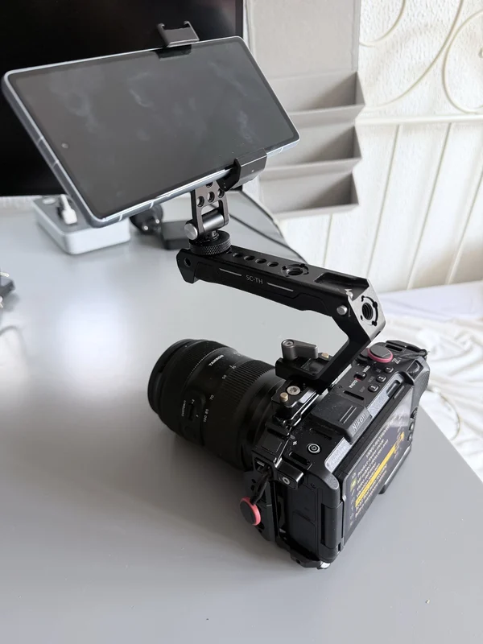
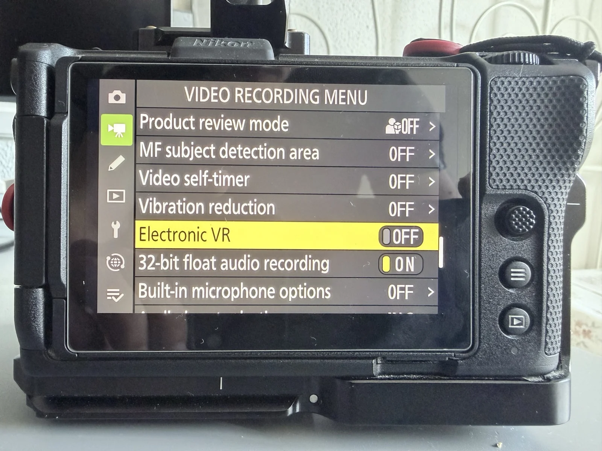
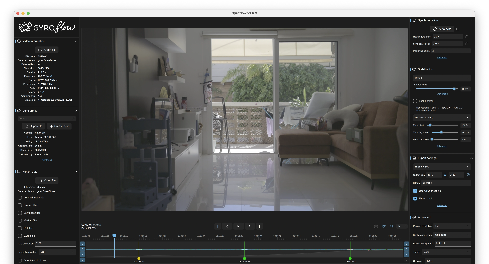

OpenZCine can record the mounted phone's gyroscope alongside a directly
connected camera's video. Transfer the resulting `.gcsv` file to Gyroflow to
stabilize the footage. This workflow is available on iOS and Android.

The phone must be **rigidly attached to the camera**, and OpenZCine must stay
**open in the foreground** throughout recording. A loose holder or a phone
that moves after calibration changes the alignment and can cause wobble.

## Test setup

The initial field tests used a Nikon ZR, a Tamron 35–100 mm f/2.8 lens, and a
phone holder fixed to a SmallRig cage. Both an iPhone 17 Pro Max and a Pixel 7a
were tested. Clips were recorded at fixed 35 mm and 100 mm focal lengths in
4K at approximately 24 fps; the 35 mm test included f/2.8.



*Example rig with the phone fixed to the top handle. Keep the holder's angle
unchanged after mount calibration.*

For a first test:

- Turn off camera/lens **VR** and **Electronic VR**. On the ZR, open the
  **Video recording menu** and set **Vibration reduction** and **Electronic VR**
  to **Off**. The phone measures camera body movement, not independent movement
  inside the lens or sensor.
- Keep the zoom fixed. Use a lens profile for that focal length and camera
  recording mode. Use manual focus while checking the setup.
- The test recordings used a **45° shutter angle**, approximately 1/192 s at
  24 fps. A short exposure reduces motion blur during stabilization. This is
  a test setting, not a requirement for every shoot; it needs more light and
  gives motion a crisper appearance than a 180° shutter.
- Start with a short handheld take while standing still. Include some gentle
  rotation so Gyroflow can synchronize the motion. Check this before trying
  a walking shot or a long take.



*Both stabilization settings are Off in the ZR's Video recording menu.*

Successful short tests do not establish long-take drift or thermal behavior.
Gyro stabilization corrects rotation; it cannot remove all perspective changes
from walking or movement between foreground and background objects.

## Connect and prepare the phone

1. Fix the phone firmly to the cage. A tilted screen is fine when using
   automatic mount calibration, provided the holder cannot move.
2. Connect OpenZCine directly to the ZR and open live view. For camera Wi-Fi,
   use the ZR's **Connect to computer** setup and join its network on the
   phone. Follow [ZR connection and reconnect](../../devices/zr/connection/)
   for the available connection paths.
3. Keep recording stopped while calibrating. This workflow supports one
   directly connected camera, not a relay viewer or multicam session.

## Calibrate the phone mount

Open **Operator Setup → Controls → Phone mount → Configure → Calibrate**.
Keep the phone fixed in its holder and move the **whole rig**. Hold still for
at least two seconds before capturing each pose:

1. Camera approximately level: tap **Capture**.
2. Lens pointing up about **25–35°**, with the camera's roll level: tap
   **Capture**.
3. Lens still pointing up, about **35–45°**, with the camera's top leaning
   **40–45° left or right**, viewed from behind: tap **Verify**.

Wait for the verified/calibrated mount confirmation. If the final pose is
rejected, keep the lens pointing upward while adding the sideways lean, then
hold still before trying again. Use **Restart** to repeat the sequence.

Repeat calibration whenever the phone moves in the holder, including a small
shift while tapping the screen. Rotating the whole rig or changing the app's
portrait/landscape display does not require recalibration.

Mount calibration aligns the phone's axes to the camera. It does not select a
lens profile or synchronize the log with the video.

## Enable logging and share the file

1. In **Operator Setup → Controls**, enable **Log gyro with camera recordings**.
2. Return to the monitor and wait for **GYRO ARMED**.
3. Start and stop recording normally from the app, camera, or connected remote.
   OpenZCine creates one gyro log for each camera-reported take.
4. After stopping, leave the app open for a few seconds to finish the log.
5. Open **Operator Setup → Storage → Gyro logs**, find the matching completed
   take, and tap **Share** to transfer its `.gcsv` file to the computer.
6. Transfer the matching camera movie too. Keep both files together so you can
   identify the correct pair.

The log includes motion before and after the observed recording boundaries,
so it can be longer than the video. This is expected. Gyroflow aligns their
contents during synchronization; matching file durations are unnecessary.

Do not lock the phone, switch away from OpenZCine, or disconnect during the
take. These events interrupt logging. An interrupted log may contain useful
motion, but check its coverage before using it. Logging does not stop the
camera recording.

## Create or choose a lens profile

Phone-mount calibration and lens calibration are separate steps. Gyroflow
needs a profile matching the camera, lens, focal length, and field of view of
the recording mode. OpenZCine does not provide lens profiles.

For the Tamron 35–100 mm tests, separate profiles were created at **35 mm** and
**100 mm** because a suitable profile was not available. If your combination
is missing, follow the official
[Gyroflow lens-calibration guide](https://docs.gyroflow.xyz/app/getting-started/lens-calibration).
Open **Lens profile → Create new** in Gyroflow to begin.

Use the corresponding profile for each fixed focal length. Check the aspect
ratio and any sensor crop or digital processing; do not assume a profile for
another recording mode will fit. An original camera file is the clearest
starting point for checking the workflow.

## Prepare the clip in Gyroflow



*Gyroflow 1.6.3 example. Stabilization and export values are specific to this
clip; follow the panel names in the steps below.*

1. **Video information → Open file:** load the camera movie.
2. **Lens profile → Open file:** import the matching lens-profile `.json`, or
   choose the matching profile from the database.
3. **Motion data → Open file:** load the take's `.gcsv` file.
4. For an automatically calibrated OpenZCine log, keep the imported **IMU
   orientation `XYZ`** and leave additional **Rotation at zero**. The app has
   already rotated these samples into camera axes. Preset logs include their
   selected orientation too: keep that imported value rather than forcing
   `XYZ`. Unconfigured logs need their alignment set in Gyroflow.
5. Under **Synchronization**, run **Auto sync**. The tested setup used three
   sync points and a 3-second search size. These are starting values, not
   guaranteed settings for every take. The log's approximate REC offset can
   help locate the overlap, but it is not a measured video synchronization.
6. Play the beginning, middle, and end. Check that stabilization improves the
   image and that the sync points agree. Increase the search range if it does
   not cover the external log's offset. See
   [Gyroflow synchronization](https://docs.gyroflow.xyz/app/getting-started/basic-usage/synchronization)
   for finding and correcting sync points.
7. Adjust stabilization and crop while watching the result. Smoothness and
   zoom settings depend on the clip; copying values from another take is not
   part of mount calibration.
8. Use **Export → Export project file (including gyro data)** to save a
   **`.gyroflow` project** for Resolve. This keeps the motion data with the
   settings. Alternatively, export a stabilized video directly from Gyroflow.

## Use the project in DaVinci Resolve

Install the official
[Gyroflow OpenFX plugin](https://github.com/gyroflow/gyroflow-plugins), then add the
**Gyroflow** effect to the matching original movie in Resolve. In the tested
workflow the effect automatically opened the saved `.gyroflow` project.

Keep the project beside the movie with the same base filename, for example:

```text
clip.MOV
clip.gyroflow
clip.gcsv
```

The `.gcsv` filename does not need to match the movie; load the correct file
in Gyroflow before saving the project. If the plugin does not find the project,
use **Browse** in the effect's controls. After changing and saving the
project in Gyroflow, use **Reload Project** in Resolve. Automatic lookup depends
on the plugin/Resolve version; see the
[official Resolve guide](https://docs.gyroflow.xyz/app/video-editor-plugins/davinci-resolve-openfx).
Check the result in Resolve before rendering. Avoid applying a second
stabilization pass to an already stabilized export.

## If the picture still wobbles

Check the mount has not shifted, then verify the selected lens profile,
focal length, VR settings, and synchronization. Calibrate the mount again
if its position changed. Compare a stationary handheld take with a walking
take: improvement while standing still can help separate rotational alignment
from perspective changes during walking.

Start with the original movie and keep rolling-shutter settings specific to
that recording mode. A lens profile or phone-mount calibration alone does not
measure the camera's sensor readout time.
